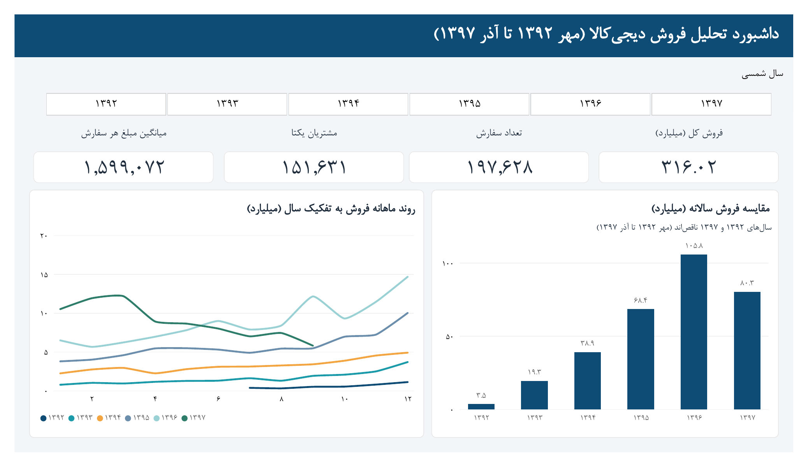
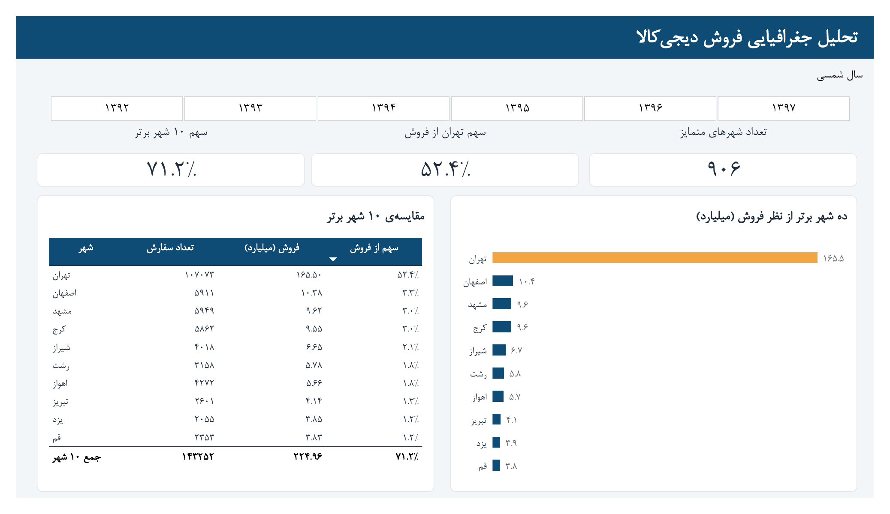
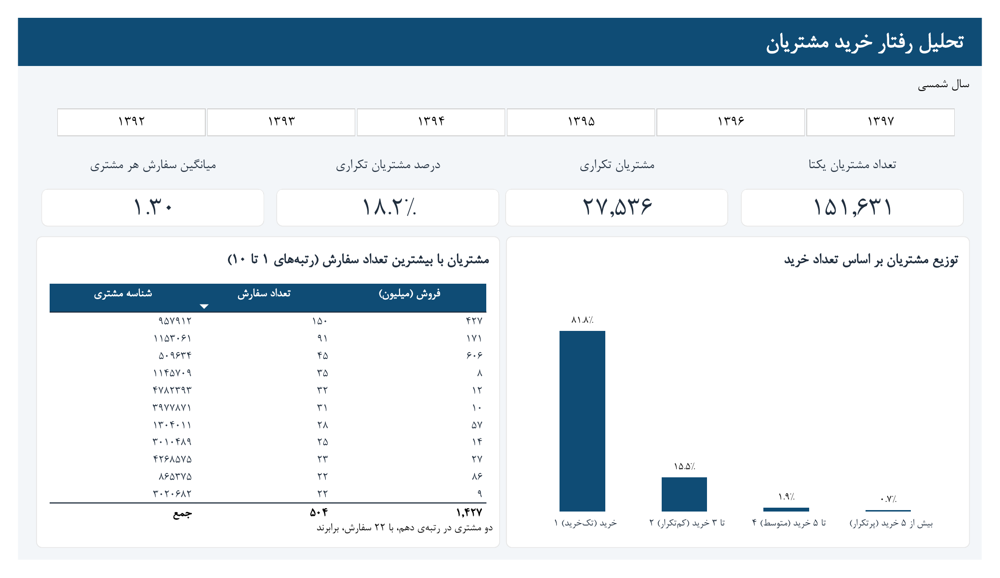
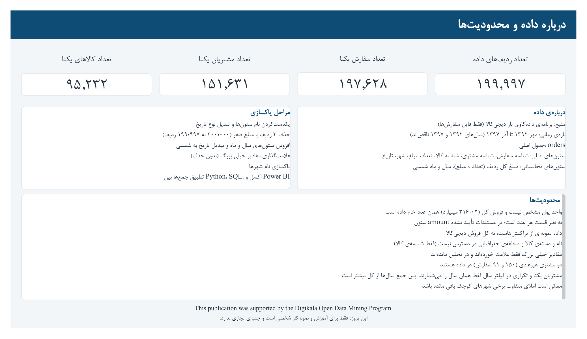
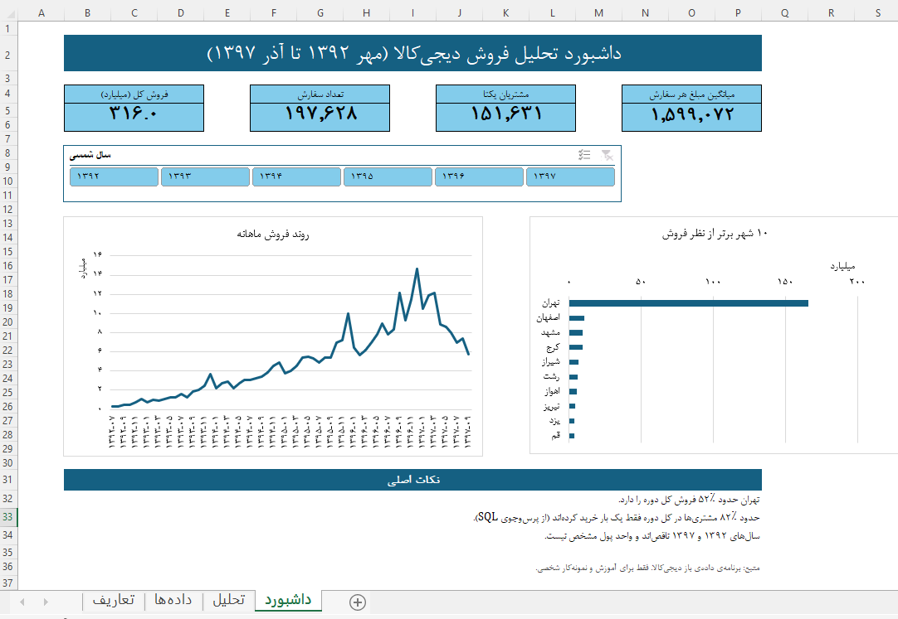
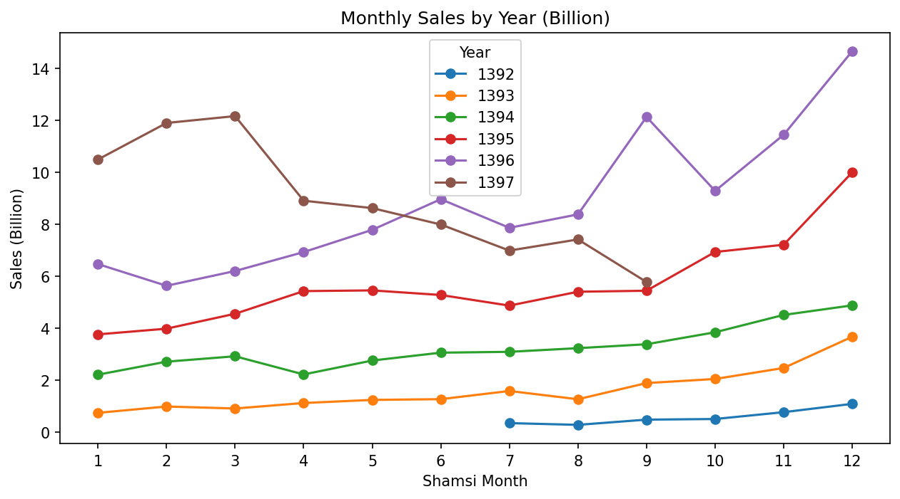
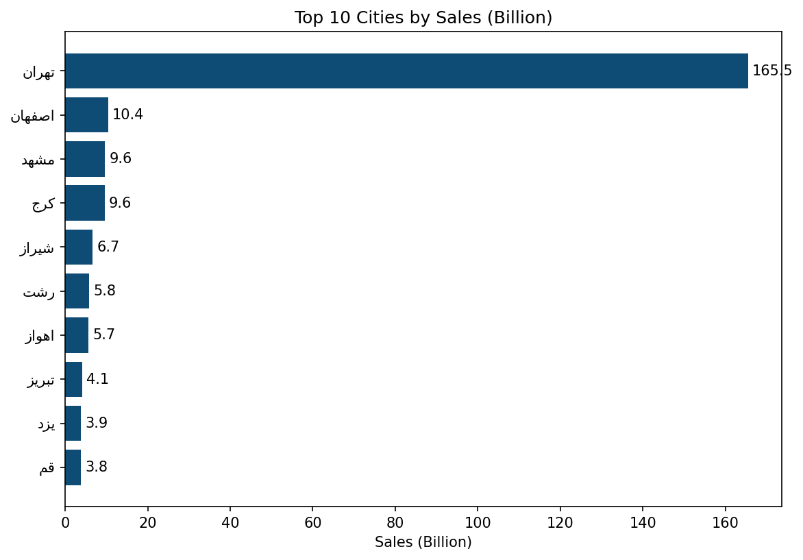
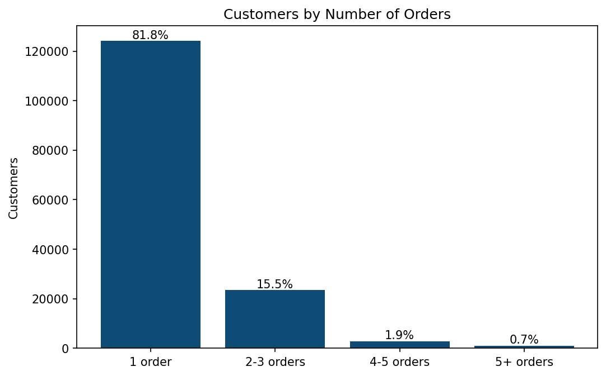
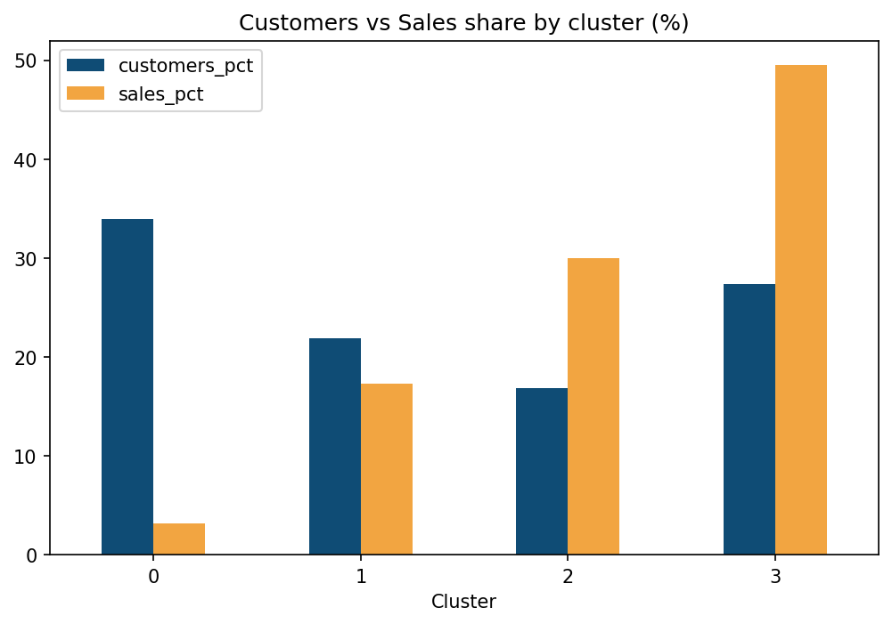

# DigiKala Sales Analysis

Analysis of about 200,000 Digikala orders (2013 to 2018) with Python, SQL Server, Excel and Power BI: sales trends, city analysis, customer behavior and an RFM + K-Means customer segmentation.

# تحلیل فروش دیجی‌کالا

این پروژه تحلیل حدود ۲۰۰ هزار سفارش دیجی‌کالا (مهر ۱۳۹۲ تا آذر ۱۳۹۷) است. مسیر کار از داده‌ی خام تا گزارش نهایی طی شده: پاک‌سازی با Python، تحلیل با SQL Server، گزارش در Excel و داشبورد چهارصفحه‌ای در Power BI، و در آخر یک بخش‌بندی مشتریان با RFM و K-Means.

## سؤال‌های تحلیلی

- فروش در سال‌ها و ماه‌های مختلف چطور تغییر کرده؟
- کدام شهرها بیشترین سهم فروش را دارند؟
- مشتریان چند بار خرید کرده‌اند و چند درصدشان تکراری هستند؟
- مشتریان را می‌شود به گروه‌های کاربردی تقسیم کرد؟

## یافته‌های اصلی

**کلیات:** ۱۹۷٬۶۲۸ سفارش یکتا، ۱۵۱٬۶۳۱ مشتری یکتا و ۹۵٬۲۳۲ کالای یکتا. فروش کل ۳۱۶٫۰۲ میلیارد (واحد پول در داده مشخص نیست) و میانگین مبلغ هر سفارش حدود ۱٬۵۹۹٬۰۷۲.

**فروش سالانه (میلیارد):**

| سال | 1392 | 1393 | 1394 | 1395 | 1396 | 1397 |
| --- | --- | --- | --- | --- | --- | --- |
| فروش | 3.5 | 19.3 | 38.9 | 68.4 | 105.8 | 80.3 |

سال‌های ۱۳۹۲ و ۱۳۹۷ ناقص‌اند (داده از مهر ۱۳۹۲ شروع می‌شود و در آذر ۱۳۹۷ تمام می‌شود)، پس افت ظاهری ۱۳۹۷ را نمی‌شود کاهش واقعی فروش دانست.

**شهرها:** تهران ۵۲٫۴٪ فروش (۱۶۵٫۵ میلیارد) را دارد و ۱۰ شهر برتر روی هم ۷۱٫۲٪.

**مشتریان:** ۸۱٫۸٪ مشتریان فقط یک بار خرید کرده‌اند. ۲۷٬۵۳۶ مشتری (۱۸٫۲٪) تکراری هستند و میانگین سفارش هر مشتری ۱٫۳۰ است. دو مشتری با ۱۵۰ و ۹۱ سفارش غیرعادی‌اند، ولی سهمشان از فروش فقط ۰٫۱۴٪ و ۰٫۰۵٪ است و در تحلیل نگه داشته شده‌اند.

**اعتبارسنجی:** جمع فروش، تعداد سفارش یکتا و تعداد مشتری یکتا در Python، SQL Server، Excel و Power BI با هم یکی است.

## بخش‌بندی مشتریان (RFM و K-Means)

برای هر مشتری سه معیار ساخته شد: recency (روز از آخرین خرید)، frequency (تعداد سفارش یکتا) و monetary (جمع خرج). از frequency و monetary لگاریتم گرفته شد، همه‌ی معیارها هم‌مقیاس شدند و با بررسی inertia و silhouette، تعداد گروه‌ها ۴ انتخاب شد.

| گروه | توصیف | سهم از مشتریان | سهم از فروش |
| --- | --- | --- | --- |
| 0 | تک‌خرید کم‌هزینه | 33.9% | 3.2% |
| 1 | مشتریان قدیمی (حدود ۳ سال خرید نکرده‌اند) | 21.9% | 17.3% |
| 2 | مشتریان تکراری | 16.8% | 30.0% |
| 3 | تک‌خرید پرهزینه | 27.4% | 49.5% |

گروه‌های ۲ و ۳ با ۴۴٪ مشتریان حدود ۸۰٪ فروش را ساخته‌اند. گروه ۳ شامل ۲۷٪ مشتریان است، نصف فروش را آورده و فقط یک بار خرید کرده است.

**نکته:** مقدار silhouette حدود ۰٫۳۵ است، یعنی گروه‌ها جدایی تیزی ندارند. این بخش‌بندی یک دسته‌بندی کاربردی است، نه کشف گروه‌های طبیعی. چون ۸۲٪ مشتریان فقط یک بار خرید کرده‌اند، معیار frequency فقط گروه ۲ را جدا می‌کند و recency هم در سه گروه نزدیک هم است.

## تصاویر

### داشبورد Power BI






### داشبورد Excel



### تحلیل اکتشافی و مدل (Python)






## ابزارها

- **Python:** pandas، numpy، matplotlib، seaborn، scikit-learn، persiantools
- **SQL Server:** بارگذاری داده و چهار پرس‌وجوی تحلیلی (`sql/analysis.sql`)
- **Excel:** جدول، PivotTable، نمودار و اسلایسر سال شمسی
- **Power BI:** مدل داده، Measureهای DAX و داشبورد چهارصفحه‌ای

## ساختار پروژه

```
DigiKala-Sales-Analysis/
├── data/               توضیح داده (خود داده منتشر نشده)
├── notebooks/
│   ├── 02_eda.ipynb                 تحلیل اکتشافی
│   └── 03_rfm_segmentation.ipynb    بخش‌بندی مشتریان
├── src/                اسکریپت‌های پاک‌سازی و بارگذاری
├── sql/analysis.sql    پرس‌وجوهای تحلیلی
├── powerbi/            فایل تم داشبورد
├── reports/
│   ├── data_quality.md     گزارش کیفیت داده
│   └── figures/            تصاویر
├── requirements.txt
└── README.md
```

## روش اجرا

1. Python 3.11 نصب باشد و کتابخانه‌ها نصب شوند:

```
pip install -r requirements.txt
```

2. داده‌ی سفارش‌ها را از برنامه‌ی داده‌کاوی باز دیجی‌کالا دریافت کن و در `data/raw` بگذار. داده در این مخزن منتشر نشده است.
3. اسکریپت‌های پوشه‌ی `src` مراحل پاک‌سازی و بارگذاری را انجام می‌دهند. بارگذاری به SQL Server روی کامپیوتر خودت (`localhost`) و پایگاه‌داده‌ی `DigikalaDB` نیاز دارد.
4. نوتبوک‌ها فایل `data/processed/orders_clean.csv` را می‌خوانند.

## محدودیت‌ها

- واحد پول مشخص نیست.
- ستون amount به نظر قیمت هر عدد کالاست، ولی در مستندات داده تأیید نشده.
- داده نمونه‌ای از تراکنش‌هاست، نه کل فروش دیجی‌کالا.
- نام شهرها یکدست نشده (حدود ۹۰۶ مقدار) و ممکن است املای متفاوت برخی شهرهای کوچک باقی مانده باشد.
- نام و دسته‌ی کالا در دسترس نیست، فقط شناسه‌ی کالا.
- مقادیر خیلی بزرگ فقط علامت خورده‌اند و حذف نشده‌اند.
- مشتریان یکتا در فیلتر سال فقط همان سال را می‌شمارند، پس جمع سال‌ها از کل بیشتر است.

جزئیات بیشتر در [reports/data_quality.md](reports/data_quality.md).

## منبع داده

This publication was supported by the Digikala Open Data Mining Program.

داده برای استفاده‌ی غیرتجاری و با ذکر منبع است. این پروژه فقط برای آموزش و نمونه‌کار شخصی است و جنبه‌ی تجاری ندارد. داده‌ی خام، فایل Excel و فایل Power BI در این مخزن منتشر نشده است.